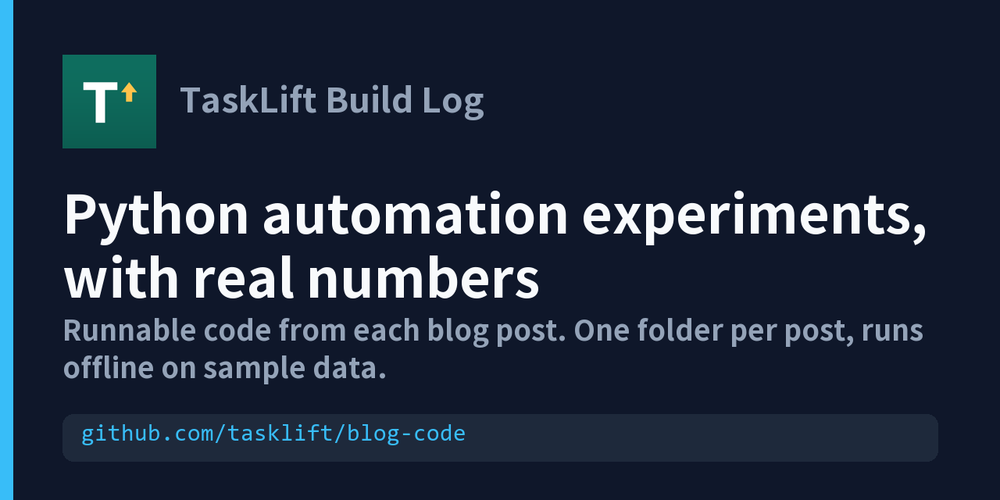
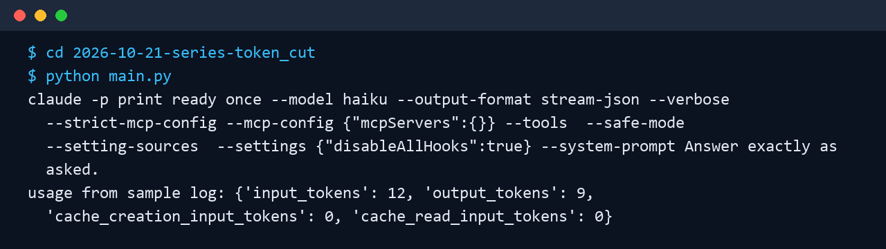

<p align="center"></p>

# Python automation experiments, with real numbers

Small scripts from my blog posts, each one runnable offline on sample data. Copy a folder, run `python main.py`, and see the same measurement method I used.

[](https://github.com/tasklift/blog-code/actions/workflows/ci.yml) [](LICENSE) [](https://www.python.org/)

한국어: 블로그 글마다 코드를 한 폴더씩 모았습니다. 견본 데이터가 들어 있어 인터넷 없이 `python main.py` 한 줄로 돌아갑니다.

## Try it in 30 seconds

```bash
git clone https://github.com/tasklift/blog-code
cd blog-code/2026-10-21-series-token_cut
python main.py
```



## What's inside

- **[Cut the token cost of automated Claude Code calls](2026-10-21-series-token_cut/)** - Shrink the context of automated `claude -p` calls with a few flags, and sum token usage from the stream-json log. In the post, one call dropped from 39,967 to 900 context tokens (-97.7%), measured once per condition with haiku.
  [한국어 글](https://chon91.tistory.com/4) | [한국어 글 (Velog)](https://velog.io/@tasklift/Claude-Code-%EC%9E%90%EB%8F%99-%ED%98%B8%EC%B6%9C-%EB%AC%B8%EB%A7%A5-4%EB%A7%8C900%ED%86%A0%ED%81%B0-%EC%8B%A4%EC%B8%A1%EA%B8%B0)
- **[How concentrated are views? Median vs mean vs top 10%](2026-10-21-data-pool_concentration/)** - Median vs mean and top-10% share of a view-count list, to judge a channel against its own median. In the post, the top 10% of 1,381 videos took 64.3% of all views (median 28,296, mean 165,972).
  _post link appears here once it is published_
- **[Does title length change the hit rate?](2026-10-21-data-title_features/)** - Hit rate (views at least 3x the channel median) by title length bucket. In the post, 14.0% of 719 videos were hits; 5.8% at 15 characters or fewer vs 16.5% at 36 or more (correlation only).
  _post link appears here once it is published_
- **[Which post formats win on community boards](2026-10-21-harvest-community_patterns/)** - Top-10% view threshold of a board and how over-represented each post format is among top posts. In the post, 2,944 classified posts from 10 boards; one board's top-10% threshold was about 7.9x its median.
  _post link appears here once it is published_
- **[Does a cloned voice stay the same? ECAPA scoring](2026-10-21-harvest-voice_ecapa/)** - Score TTS chunks against a reference voice with cosine similarity and flag the drifting ones. In the post, 51 Korean chunks had median similarity 0.806 and 10 were below 0.75; 108 English chunks had none below 0.75.
  [Read the post (dev.to)](https://dev.to/tasklift/does-a-cloned-voice-stay-the-same-scoring-qwen3-tts-with-ecapa-39pd) | [Read the post (Medium)](https://medium.com/@tasklift/does-a-cloned-voice-stay-the-same-scoring-qwen3-tts-with-ecapa-8ed81c6ddaca)
- **[A/B/C image prompt tests on shared seeds](2026-10-21-harvest-zimage_ab/)** - Expand an A/B/C setting block into one job per variant and seed, so variants are compared on the same seeds. In the post, with 4 seeds per condition, removing negative wording and raising cfg to 2.0 gave 0 of 4 images with modern objects.
  _post link appears here once it is published_
- **[A scene contract to check AI pictures against the script](2026-10-21-series-scene_contract/)** - A scene contract schema, a grading prompt and a pass rule for checking AI pictures against the script. In the post, before the contract only 3 of 16 scenes passed on the first candidates (about 19%).
  _post link appears here once it is published_
- **[One-line intro length check for OG images](2026-10-21-harvest-dev-biz-landing-template-kit/)** - Length check for a one-line intro so it is not cut off in an OG image. In the post, the template kit passed all 6 hidden checks and the AI-reported count matched (6 of 6).
  _post link appears here once it is published_
- **[A polite first web crawl with requests and BeautifulSoup](2026-10-21-evergreen-kwbcbc90/)** - Polite first crawl with requests and BeautifulSoup, runnable offline on a sample and live on a practice site. The offline check parses a 3-item sample; no performance numbers are claimed.
  [한국어 글](https://chon91.tistory.com/6)

## Questions and links

Questions or ideas: use the Discussions tab, or comment on the post.

- [Blog posts in English (dev.to)](https://dev.to/tasklift)
- [Blog posts in English (Medium)](https://medium.com/@tasklift)
- [한국어 글 (Velog)](https://velog.io/@tasklift)
- [Gumroad: Korean one-page website builder](https://tasklift.gumroad.com/l/one-page-website-builder)

License: MIT
